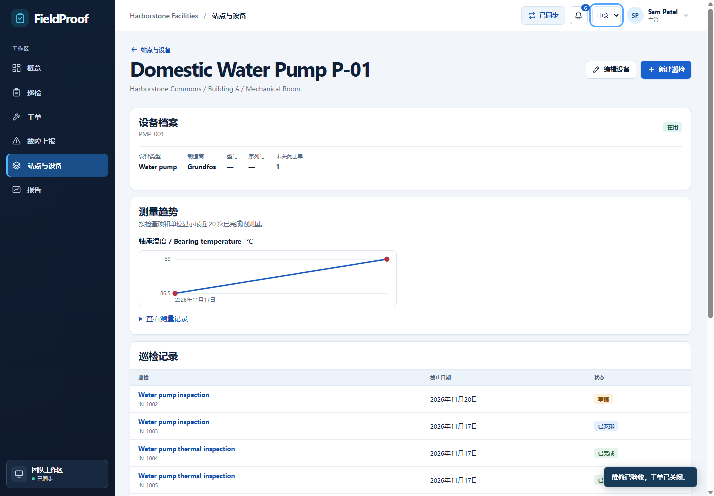
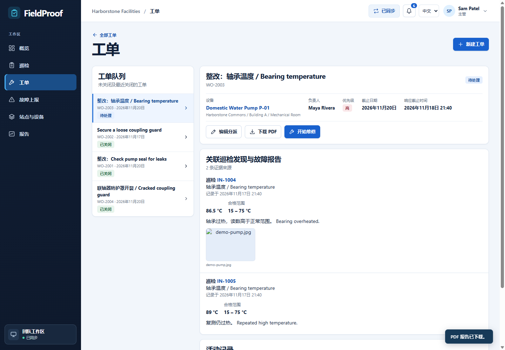
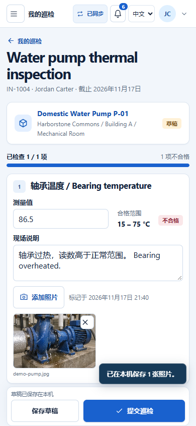
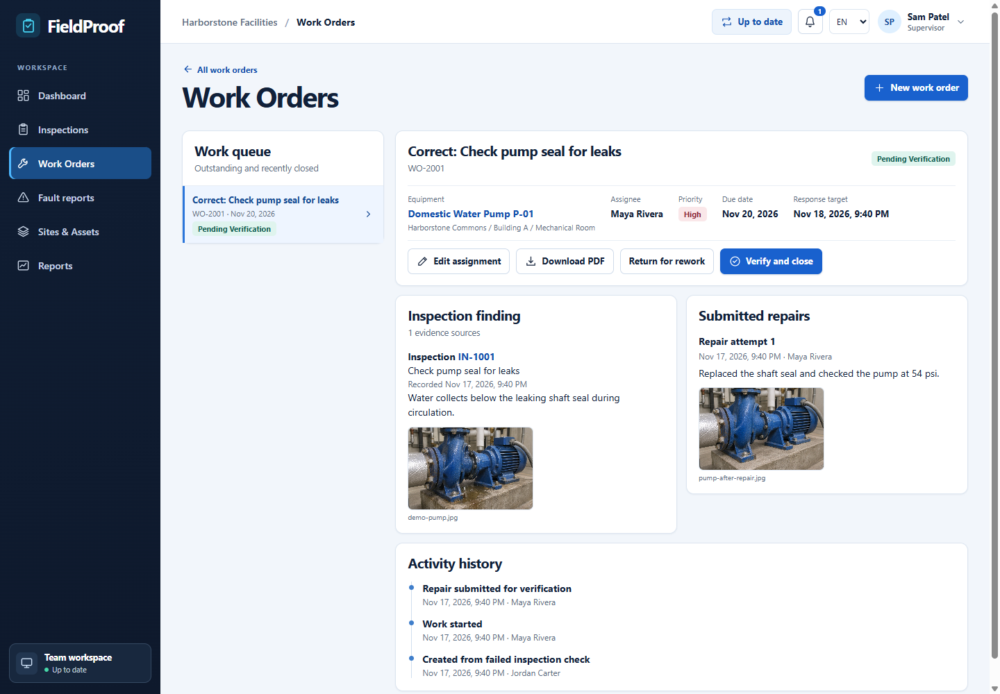

# FieldProof Team 2.1

[简体中文使用与部署指南](README.zh-CN.md)

FieldProof Team shares inspections, equipment records, photos, and corrective work through one server. Each person signs in with their own account. An inspection failure creates a work order linked to its check and equipment. Submitted repairs retain their evidence and go to an independent reviewer.

## Core features

| Area | What it supports |
| --- | --- |
| Equipment and inspections | Site and equipment registers, reusable checklists, recurring schedules, and role-specific task queues. |
| Offline fieldwork | Save drafts, measurements, and photos on a trusted device. Sync when the connection returns and review conflicting edits. |
| Faults and corrective work | Report unexpected faults, link repeat findings to a single order, set response targets, and route repairs to an independent reviewer. |
| Measurements and reporting | Check readings against saved limits, review equipment trends, and export evidence and repair history in English, Simplified Chinese, or a bilingual PDF. |
| Administration | Individual accounts, server-enforced roles, in-app notifications, audit history, and workspace backup and restore. |

## Open FieldProof on Windows

1. Extract the release ZIP to a folder you control. Install [Node.js 24](https://nodejs.org/) if it is missing. The release includes the built browser app and requires no package installation.
2. Double-click **Start FieldProof.cmd**. Keep the server window open and visit [http://127.0.0.1:8740](http://127.0.0.1:8740/). This address works on the server computer. For mobile and other desktops, follow **Share with your team over HTTPS** below.
3. On first launch, copy the setup code shown in the server window. Enter it on **Set up your workspace**, choose a workspace name, and create the first administrator. Setup succeeds when **Operations overview** opens. Keep the one-time setup code private.
4. In **Settings → Team members → Invite member**, enter the member's name, email, and role. Send the generated code privately to the intended recipient. The code expires after 72 hours or after its first use. The recipient opens FieldProof, selects **Activate an account**, and chooses their own password.
5. The administrator or a supervisor can register a site, building, area, and equipment in **Sites & Assets**. Create a reusable checklist in **Inspections → Templates** and assign an inspection. The assignee should see the inspection in **My Inspections**. An administrator can set a default repair assignee and corrective-action due interval in **Settings**.

The application starts with an empty team workspace. The screenshots and test fixtures use fictional Harborstone Facilities records. The previous v1.0 ZIP and private static site are separate local-data releases. Export from v1.0 and restore into Team to move those records.

### Upgrade a Team 2.0 installation

1. Sync field devices and take an SQLite snapshot with the old installation's `ops.mjs`. Save your existing `.env` and note the absolute path of the live database.
2. Stop the old server and extract 2.1 to a new directory. Copy the configuration to the new directory. Set **FIELDPROOF_DB** to the existing database and retain the same **FIELDPROOF_ORIGIN**, bind address, and port. The default database path is relative to the release folder, so set it explicitly when upgrading to a new folder.
3. Start the 2.1 server. Confirm that existing users can sign in and that older inspections, work history, and evidence are present. Use the **EN／中文** selector in the top bar to check language switching.

## Share with your team over HTTPS

Each member uses the same server URL in their own browser. The deployment requires a computer or server that remains available, a persistent database folder, and a trusted HTTPS address reachable by your team. FieldProof supplies the application and database integration. Your organization supplies the host, DNS and TLS, or a private network with trusted HTTPS.

1. Put the release on the server and install Node.js 24 or newer. Copy **.env.example** to **.env**. Set **FIELDPROOF_ORIGIN** to your exact public or private HTTPS origin without a trailing slash. Set **FIELDPROOF_TIME_ZONE** to the facility's IANA time zone. To use a different data directory, give **FIELDPROOF_DB** an absolute persistent path that the server account can write.
2. Run `node --env-file=.env server.mjs` as a persistent service under a dedicated OS account, using your platform's service manager. Leave **FIELDPROOF_BIND** at `127.0.0.1` when the HTTPS proxy shares the host. Build from source with `node build-team.mjs` if **team-dist/** is missing.
3. Direct your TLS reverse proxy to `http://127.0.0.1:8740`. For example, use this Caddy configuration after setting your domain and DNS. Caddy must be able to acquire a trusted certificate, or your organization must configure one. [Caddy reverse proxy documentation](https://caddyserver.com/docs/caddyfile/directives/reverse_proxy)
   ```caddyfile
   fieldproof.example.com {
       reverse_proxy 127.0.0.1:8740
   }
   ```
4. Visit the HTTPS address from a second device. Sign in with a separate member account and check that the newly assigned inspection is visible. Secure cookies and the offline app require HTTPS when the browser is on another device.
5. Keep the database and backup directory readable only by trusted operators. If the team works over a VPN or private network, restrict access to that network at the proxy or firewall. When you update, take a full server snapshot and keep the same database path and HTTPS origin.

FieldProof stores password hashes and session-token hashes on the server. The server checks every change against the current account and role. Account codes are exchanged by the team administrator. FieldProof does not require SMTP, an OAuth provider, a cloud account, or a third-party sync service.

## Roles

| Role | Access |
| --- | --- |
| Inspector | Assigned inspections and related evidence, on-site fault reporting, and assigned corrective work when applicable. |
| Maintenance | Assigned work orders, their linked findings and fault reports, related equipment, and on-site fault reporting. |
| Supervisor | Review fault reports, manage equipment and assignments, view analytics and reports, and independently verify repairs. |
| Admin | Supervisor access plus member management, workspace settings, audit history, and backup and restore. |

People who started or contributed to a repair attempt cannot approve that work order. Another supervisor or administrator can review it. Administrative access changes apply on the server immediately. A trusted device checks for access changes when it reconnects.

## Walk through a pump leak

1. Assign a water-pump inspection to an inspector. Have the inspector open **My Inspections** on their phone. **Overdue**, **Due today**, and **Upcoming** use the workspace's time zone.
2. Before leaving coverage, sign in on a trusted device and select **Synchronization → Prepare for offline work**. Wait for **The offline app is ready**. The preparation dialog reports how many assigned evidence photos are cached.
3. With the device offline, open the inspection, mark the seal check **Fail**, add a finding note and photo, and mark the other checks **Pass**. Save the draft or select **Submit inspection**. A queued submission is stored locally and stays linked to the inspection after a browser reload.
4. When connectivity returns, leave FieldProof open to let the queue send automatically. **Sync now** is available in **Synchronization**. Success is **Up to date**, a **Completed** inspection, and corrective work linked to each failed check. If your session expired, sign in again with the same account.
5. The assigned maintenance worker opens **My Work**, selects **Start work**, adds a repair note and completion photos, and selects **Request verification**. The order moves to **Pending Verification** after the server accepts it.
6. A separate supervisor can select **Return for rework** with a reason or **Verify and close**. The closed order keeps each repair attempt and decision. The equipment history, dashboard, and PDF reflect the recorded work.

### Repeated findings and unexpected faults

- When a failed check has outstanding work on the same equipment, the submission screen lets the inspector choose an existing order, make a separate order, or use the automatic match. Automatic matching requires the same equipment, template and check. Numerical checks must also fail on the same side of the range. A closed order is ineligible.
- The work order shows all linked inspections and fault reports, with the original notes, readings and photographs. When a new finding is linked to an order awaiting verification, FieldProof returns it to **In Progress** so the new evidence can be addressed. If a chosen order closed while the device was offline, sync flags the submission instead of silently assigning it elsewhere.
- Use **Fault reports → Report a fault** to record a problem outside a checklist. Select the equipment, severity, and an optional evidence photo. Fault reports can be queued offline. A supervisor reviews the report, creates and assigns a work order, links it to an outstanding order on the same equipment, or declines it with a reason.

### Measurements, priorities and notifications

- In the template editor, select **Numerical measurement**. Enter a unit such as °C, psi, or V, and at least one limit. Limits are inclusive. Scheduled inspections retain the limits and units in their checklist snapshots. FieldProof calculates pass or fail from the saved reading, including during offline capture.
- Open an asset's **Measurement trends** to see the latest 20 completed readings for each check and unit. Select **View readings** for exact values and inspection links. Red points are outside the recorded range.
- **Settings → Response targets (hours)** configures when work should start, from creation. Defaults are 4 hours for Urgent, 24 for High, 72 for Medium, and 168 for Low. The order keeps a separate repair due date. Raising the priority can shorten an unstarted order's response target. A previously configured target on an order stays in its history.
- The notification bell shows assignments, overdue inspections or work orders, new evidence, fault reviews and decisions, and repair review updates. Notifications appear in the app when FieldProof is open and the device syncs. Opening a notification marks it read on the server.

### Languages and reports

Switch between English and Simplified Chinese with the keyboard-accessible **EN／中文** control. FieldProof remembers the choice in that browser. Interface labels and system messages switch language. User-entered equipment names, observations, and notes retain their original wording.

On **Reports**, choose **Current language**, **English**, **简体中文**, or **English + 简体中文** before downloading. PDFs embed the bundled Noto Sans SC font and preserve mixed Chinese and English text as selectable text. The offline app caches the font alongside the other app files. [Font license](src/fonts/OFL.txt)

### Offline conflicts

Changes to separate fields can sync independently. If someone edits the same field, closes the record, or changes its assignment before a queued edit arrives, FieldProof shows **Review sync issue**. Use **Export unsynced changes** to preserve local notes and photos, then **Use server version** to discard the conflicting edit and continue. Review the current record and re-enter the observation if appropriate. FieldProof never automatically overwrites a conflicting record. An unsynced export is a recovery reference for manual review.

## Data, reports, and recovery

- The server commits records, evidence, audit events, and operation receipts in SQLite transactions. A repeated submission with the same operation ID returns the original result. Work orders and photos cannot be left half-created by a failed write.
- Notes and new photos save to the trusted device's outbox before sending. An offline lease lasts up to 72 hours and depends on the last authenticated server session. Autosync runs while FieldProof is open. Device storage can be cleared by the browser or OS. Previously attached photos must be cached to view offline. Preparation prioritizes up to 80 photos for open assigned records. Keep devices locked and sign out after syncing on shared hardware.
- Recurring schedules run on server startup and at the facility's date change. The scheduler generates missed and upcoming dates without recreating existing occurrences. A manager can reassign an existing recurring inspection while keeping its due date. Schedule edits affect future generation.
- **Settings → Export backup** includes records, equipment relationships, photographs, and repair history. Restoring replaces shared work records and keeps current member accounts. Imported v1.0 profile names become historical attributions. Invite actual accounts and reassign open inspections and work orders to them after import. Logical restore accepts requests up to 96 MiB. Use full database snapshots for larger workspaces and server audit and account recovery.
- Run `node --env-file-if-exists=.env ops.mjs snapshot <new-file.sqlite>` to take a consistent SQLite snapshot, including while the service is running. Store it privately because it contains account, session, and evidence data. To restore a full server snapshot, stop the service, preserve the current database and SQLite companion files as a set, point **FIELDPROOF_DB** at a copy of the snapshot in a clean directory, then restart and verify access. An operator with direct database access can run `node --env-file-if-exists=.env ops.mjs recover-admin <email>` to revoke the administrator's sessions and issue a one-hour recovery code.
- Completion counts submitted inspections among those due in the selected period. Open work includes orders awaiting verification. Overdue includes missed response targets and open orders past their repair due date. Work activity trends use creation and closure dates. Site filters use the equipment's current location.
- PDFs include linked findings, measurements, timestamps, photographs, repair attempts, and verification history. The embedded font covers Simplified Chinese and Latin text. Glyphs outside the font's coverage, such as some emoji, may not render. Browser records and backups retain the original text.

The release is designed for one server instance and a small team. It uses a single workspace and browser polling. Installable offline behavior depends on service-worker and IndexedDB support. Browser automation covered Chromium at desktop and mobile viewport sizes.

## Screenshots









## Verified tests

1. All 13 tests passed with `node --test tests/core.test.mjs tests/team-api.test.mjs tests/team-v21.test.mjs`. Checks included permissions, concurrent duplicate linking, preservation of numerical limits and photos, fault triage, response targets, backup and restore, and rejected stale links.
2. `node build-team.mjs` builds the application. Run `node tests/team-browser.test.mjs` with Chrome installed, or set **FIELDPROOF_CHROME** to a Chromium executable. The workflow passed with four separately signed-in profiles at desktop and mobile sizes. Tests covered offline inspection and fault capture, reconnect, explicit linking, fault assignment, independent verification, language switching and persistence, and a bilingual PDF containing selectable user-entered text and evidence photos.
3. The extracted Windows launcher worked in a directory with spaces and served the built app without rebuilding. Version 2.1 opened a database created by the original Team 2.0 ZIP and preserved its account sign-in, completed inspection, linked work order, and photo. Tests used loopback and isolated databases. The HTTPS example configures your own team host. The original v1.0 Sites address continues to serve the standalone release.

The workflow draws on [MaintainX offline work](https://help.getmaintainx.com/offline-mode), [work request review](https://help.getmaintainx.com/approve-or-decline-work-requests), [measurement and corrective action triggers](https://help.getmaintainx.com/trigger-a-work-order), and [task notifications](https://help.getmaintainx.com/about-notifications).
