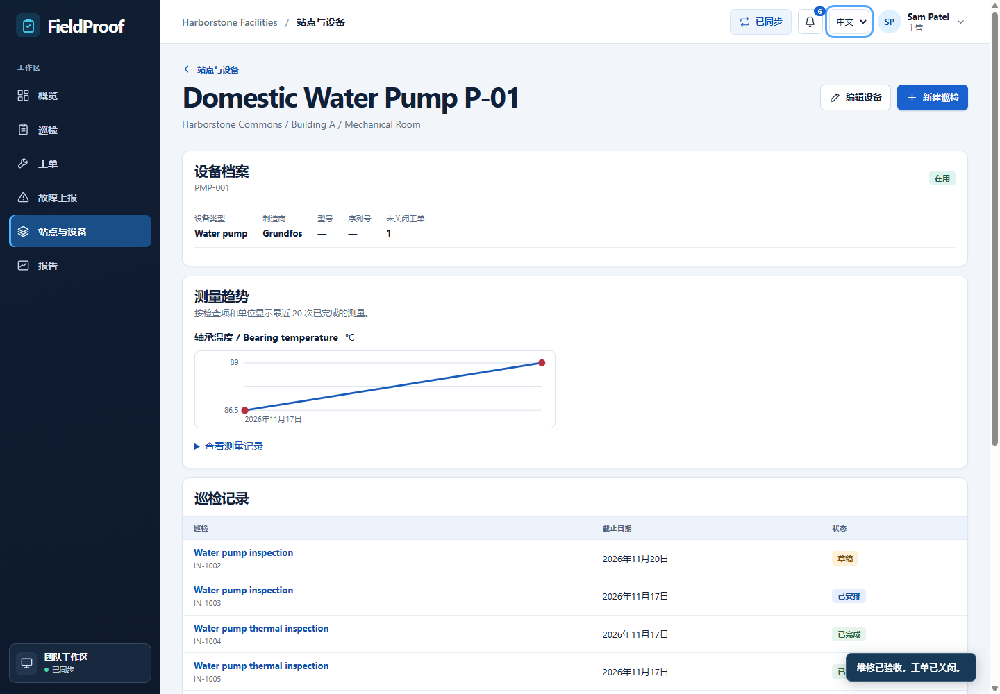
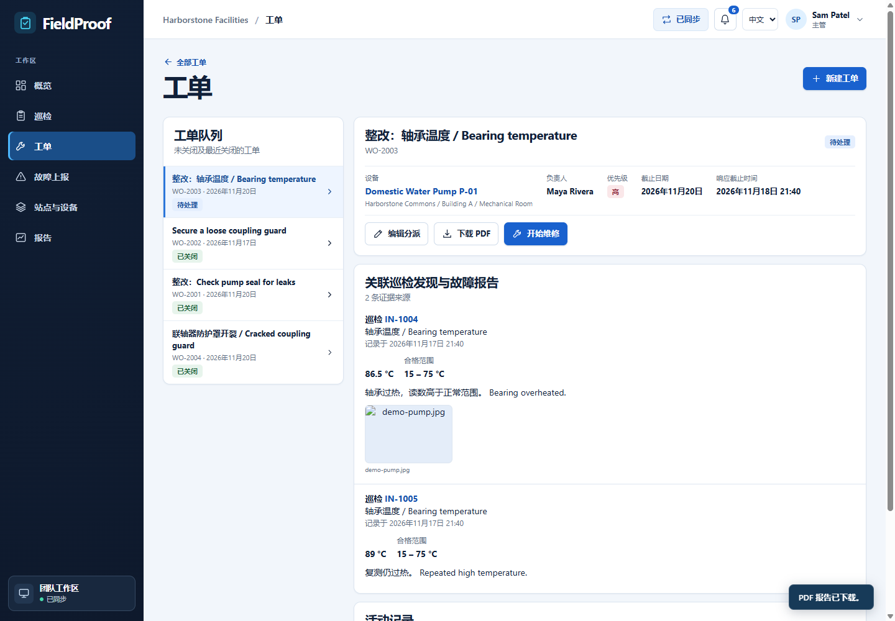
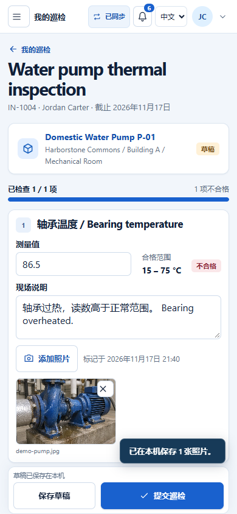

# FieldProof Team 2.1 使用指南

[English guide](README.md)

FieldProof 适用于物业和设施维护团队。巡检员记录检查结果和现场证据，维修人员处理工单，未参与维修的主管负责验收。团队成员使用独立账户，在同一服务器同步设备、巡检、故障和维修记录。

## 核心功能

| 工作场景 | 支持内容 |
| --- | --- |
| 设备与巡检 | 站点和设备台账、可复用清单、周期计划及按角色分派的任务。 |
| 离线现场工作 | 在可信设备上保存草稿、读数和照片，联网后同步并核对冲突记录。 |
| 故障与整改 | 上报意外故障、合并重复发现、配置响应时限、记录维修与独立验收。 |
| 测量与报告 | 自动判断是否超限、查看设备趋势、导出英文、简体中文和双语 PDF。 |
| 团队管理 | 独立账户、服务器权限控制、应用内提醒、审计记录及备份恢复。 |

## Windows 启动与团队部署

1. 将 ZIP 解压到有写入权限的位置。服务器需安装 [Node.js 24](https://nodejs.org/)。发布包已包含构建后的应用。
2. 双击 **Start FieldProof.cmd**，保留窗口，在浏览器打开 [本机应用](http://127.0.0.1:8740/)。首次启动时，将窗口显示的设置码填入网页，创建首个管理员。成功标志是进入“运营概览”。
3. 在**设置 → 团队成员 → 邀请成员**中输入邮箱和角色。将有效期为 72 小时的一次性激活码私下发送给对方。对方在登录页选择**激活账户**并创建自己的密码。
4. 其他电脑和手机需要可访问的 HTTPS 地址。将 `.env.example` 复制为 `.env`，设置 **FIELDPROOF_ORIGIN** 为准确的 HTTPS 源地址，末尾不加斜杠。设定 **FIELDPROOF_TIME_ZONE** 和持久化数据库路径 **FIELDPROOF_DB**。当 HTTPS 反向代理与 FieldProof 在同一服务器上时，将其转发到 `127.0.0.1:8740`。成功标志是另一台设备使用不同账户登录后可以查看自己被分派的巡检。反向代理示例见[英文部署说明](README.md#share-with-your-team-over-https)。

已有 Team 2.0 时，先同步现场设备并使用旧版本的 `ops.mjs snapshot` 保存数据库副本。停止旧服务，把 2.1 解压到新目录，保留同一个数据库绝对路径、站点地址和端口配置。启动后核对原有账户、巡检和照片。原 v1.0 版本可使用 JSON 备份迁移。旧本地人员资料仅保留为历史记录，应邀请真实团队账户并重新分派未完成任务。

## 现场巡检和异常处理

1. 在**站点与设备**下建立站点、楼栋、区域和设备。主管在**巡检 → 模板**下创建检查清单，随后安排巡检并分派人员。
2. 对温度、压力和电压等指标，选择**数值测量**，填写单位及至少一项限值。上下限都包含边界。现有巡检保留安排时的单位和范围，新的巡检使用最新模板。
3. 巡检员在**我的巡检**中查看逾期、今天到期和即将到期的记录。出发前在可信设备登录，打开**同步 → 准备离线工作**，等待“离线应用已就绪”。现场可离线保存测量、说明和照片。重新联网后，应用打开时将自动提交队列，也可选择**立即同步**。
4. 不合格项必须填写现场说明。当同一设备存在未关闭工单时，提交页允许关联现有工单、创建新工单或使用自动匹配。自动匹配要求同设备、同模板、同检查项。测量超限方向也必须一致。成功标志是两次检查出现在同一工单的证据区，两次检查的测量值、备注和照片均可查看。
5. 对检查清单以外的故障，打开**故障上报 → 上报故障**，选择设备、优先级并填写现场情况，可上传一张现场照片。报告可离线保存。主管审核后可以创建并分派整改工单、关联同设备现有工单，或填写原因后驳回。
6. 维修人员在**我的工单**中开始维修，填写说明、添加照片并申请验收。独立主管可退回返工或验收关闭。工单保留历次维修和审核记录。若待验收工单关联了新证据，它会返回“进行中”，待维修人员处理后再提交验收。

如出现同步冲突，先**导出未同步更改**以保存本机说明及照片，再根据情况选择**使用服务器版本**。与同一项记录相关的其他有效更改仍可在冲突处理后同步。若被选中的工单在离线期间关闭，需要重新确认关联方式。

## 优先级、语言与备份

- 在**设置 → 响应时限（小时）**设置从创建到开始维修的时间。紧急、高、中、低默认分别为 4、24、72、168 小时。维修截止日期单独记录。应用内通知包含分派、逾期、故障审核和验收等状态。
- 在设备档案查看**测量趋势**。按检查项和单位显示最近 20 次已完成的测量，红点表示超限。“查看测量记录”提供精确读数及关联巡检。
- 顶栏 **EN／中文** 可切换界面，浏览器自动记忆偏好。用户填写的中英文名称与说明保留原文。**报告 → PDF 语言**支持英语、简体中文和双语。报告内嵌字体，正常中英文可选中复制。
- 管理员可在**设置**中导出 JSON 备份或恢复记录。恢复会替换团队工作数据并保留当前账户。完整服务器备份可用 `node --env-file-if-exists=.env ops.mjs snapshot <新文件.sqlite>`，应存放在受限位置。备份包含照片、现场资料和可能的账户信息。
- 离线数据依赖受信任浏览器的本地存储，离线授权最长 72 小时。关闭应用后不会在后台同步。离线之前请确认缓存状态。工作区按单服务器、小型团队场景部署。

## 验证与截图

实际 SQLite API 的 13 项核心和集成测试通过。四个独立的 Chromium 配置分别登录，完成离线巡检与故障上报、重连同步、重复问题关联、维修及独立验收。另验证了双语 PDF 中的可选中文、英文文本和嵌入照片。2.1 成功打开了实际由旧版 2.0 创建的数据库，保留登录、巡检、整改工单及照片。测试服务运行于 Windows 本机回环地址，团队 HTTPS 地址由部署方配置。

